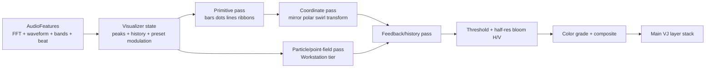

# Boris-style real-time audio visualizer

## Decision

Build an **original Boris-inspired visualizer subsystem** on the project’s most capable target first: the Windows workstation with the RTX 3090. It is technically realistic and fits the production architecture already documented in `docs/v2`.

The right implementation is a modular render graph with reusable waveform/spectrum primitives, polar mapping, feedback, glow, particles, transforms, and compositing. It should not be a port of Boris code, a dependency on the Continuum plug-in, or one monolithic fragment shader.

The Raspberry Pi can later run a deliberately reduced preset tier, but the dense point fields, multiple glow stages, persistent feedback, motion blur, and several simultaneous layers shown in the reference should initially be Workstation-only.

## What the supplied video shows

The supplied `Boris Visualizer.MP4` was inspected as a visual reference, not as an instruction source. Its technical properties are:

```text
Duration:     28.99 seconds
Video:        H.264, 720x1280, yuv420p, 25 fps
Audio:        AAC stereo, 48 kHz
File size:    23.82 MB
```

The montage contains several related visual languages:

- Cartesian spectrum surfaces and wire grids
- Mirrored or kaleidoscopic waveform geometry
- Radial bars, rings, and polar-warped spectra
- Dense glowing point/particle fields
- Organic deformed meshes and tunnel-like camera motion
- Persistence/trails, bloom, chromatic separation, and composited backgrounds

The video appears broader than a demonstration of a single spectrum-graph control. Some shots likely combine visualizer output with other procedural, particle, distortion, or compositing effects. Therefore the achievable target is the same **visual grammar and responsiveness**, not a claim that every frame can be reproduced by one shader.

## What Boris documents

Boris describes BCC+ Audio Visualizer as a generator driven by amplitude and frequency changes. It supports time-domain waveform and frequency-domain display, bars/dots/peak dots, adjustable resolution, taper, peak hold, waveform duration/offset, per-band sensitivity, frequency limits and smoothing. It then layers three-color gradients, transforms, mirroring, polar warp/swirl, motion blur, glow, color correction, and background compositing. [Boris FX: BCC+ Audio Visualizer](https://borisfx.com/documentation/continuum/bcc-audio-visualizer/)

Its documented pipeline is useful as a feature taxonomy, but the project should not reproduce host-editor features that do not make sense live:

| Boris capability | Our interpretation | Scope |
|---|---|---|
| Audio file/host layer | Live stereo USB input | Required |
| Frequency/waveform | FFT texture and PCM waveform texture | Required |
| Bars, dots, peak dot | Analytic SDF primitives | Required |
| Resolution/density/roundness | Instance/bin count and shape parameters | Required |
| Peak hold/falloff | Persistent per-bin peak state | Required |
| Band tuning/min/max/smoothing | Existing DSP plus visualizer controls | Required |
| Gradient/color correction | Linear-light palette and grade pass | Required |
| Mirror/polar warp/swirl | Coordinate transform stage | Required |
| 3D transforms/camera | Homography initially; full camera later | Phase 1/2 |
| Glow | Threshold plus separable bloom | Required |
| Motion blur | Temporal accumulation or bounded samples | Phase 2 |
| Background/source mix | Existing layer compositor | Already present |
| Mocha tracking, masks, ML | Offline-editor functionality | Excluded |
| Boris factory presets/assets | Proprietary creative content | Excluded |

Boris documents 16-bit half-float and 32-bit float GPU modes. Our default should be `RGBA16F`; `RGBA32F` is unnecessary for a live visualizer unless a measured precision defect appears. [Boris GPU rendering options](https://borisfx.com/documentation/continuum/bcc-audio-visualizer/#background-group)

## Why the RTX 3090 target is appropriate

The repository declares three capability tiers: Pi 5 Appliance, M2 Pro Portable, and RTX 3090 Workstation. The Workstation tier permits eight visible decks and up to eight shader passes, with Vulkan as the intended rendering API. Its shader ABI already includes a 128/256-bin FFT texture, a recent-waveform texture, scalar bands, onset, BPM, beat phase, bar phase, and confidence.

That means most prerequisite work is designed already:

```text
Live USB audio
  -> capture ring
  -> FFT / waveform / onset / tempo analyzer
  -> immutable AudioFeatures snapshot
  -> FFT and waveform GPU textures
  -> visualizer render graph
  -> existing layer compositor
  -> Vulkan presentation
```

The current Chromium prototype also has useful building blocks:

- `gig/src/audio.js` produces sub-bass, bass, low-mid, high-mid, treble, energy, per-band hit impulses, BPM/phase, and 32 log-spaced spectrum bins.
- `gig/src/mixer.js` already uploads those values to shaders and has layer blending and post effects.
- Existing shaders include `spectrum_bars`, `spectrum_flow`, `audio_oscilloscope`, `audio_wave_rings`, and `multiband_rings`.

The browser implementation can host an early visual prototype, but the final high-density version belongs in the planned Rust/wgpu renderer. A 32-bin spectrum is enough for stylized bars; it is not enough for the detailed surfaces and point fields in the supplied video. The production path should use 128 bins by default and allow 256 on the Workstation.

## Proposed render graph



Recommended targets:

| Pass | Format | Scale | Notes |
|---|---|---:|---|
| Primitive mask | R16F or RGBA16F | 1.0 | Crisp bars, dots, lines |
| Polar/transform | RGBA16F | 1.0 | Can merge with primitive pass for simple presets |
| Feedback/history | RGBA16F ping-pong | 0.5 or 1.0 | One bounded persistent pair |
| Particle field | RGBA16F | 0.5–1.0 | Instanced/compute path, Workstation only |
| Bloom threshold | RGBA16F | 0.5 | Downsample while thresholding |
| Bloom blur H/V | RGBA16F | 0.25–0.5 | Separable blur, pooled targets |
| Final composite | RGBA16F | 1.0 | Linear-light blend, output conversion later |

Simple presets should fuse primitive generation, polar mapping, and coloring into one pass. Allocate the full graph only when the preset requests feedback, particles, or bloom. All targets come from the existing planned pool; no steady-state allocations occur on the render thread.

## Rendering techniques

### Bars, dots, peak dots, and lines

Use analytic signed-distance primitives in a fullscreen fragment pass. For a pixel, determine its bin from the horizontal coordinate, fetch one FFT value, and evaluate a rounded rectangle, ellipse, circle, or line mask. This avoids generating and uploading hundreds of CPU-side vertices every frame.

For radial layouts, transform output coordinates to polar coordinates before choosing the FFT bin:

```glsl
vec2 p = (fragCoord * 2.0 - resolution) / resolution.y;
float radius = length(p);
float angle01 = fract(atan(p.y, p.x) / TAU + 0.5 + rotation);
float amplitude = texture(fftTexture, vec2(angle01, 0.5)).r;
```

Mirror, repeat, angular quantization, and swirl are coordinate operations around this core. The existing project’s kaleidoscope and ring shaders can be reused as implementation references, not merged blindly.

### Spectrum surfaces and ribbons

Maintain 32–128 rows of recent FFT values in a persistent history texture. Write the newest row each analysis/render tick and advance a ring index rather than shifting the texture. A shader samples `(frequency, historyAge)` and derives height, color, normal, and perspective. This creates the flowing landscape seen early in the reference without a general-purpose 3D mesh engine.

Two options:

- Phase 1: ray-marched or height-field fragment shader at half resolution.
- Phase 2: GPU-generated ribbon/mesh using instancing or a compute-populated vertex buffer.

Use the fragment version first because it integrates with ISF and is portable. Move to geometry only if profiling shows a quality/performance advantage.

### Particles and point clouds

The dense purple/blue fields in the reference should not be emulated with a fragment loop over thousands of particles. On the 3090, use a bounded GPU particle system:

```text
compute update: position, velocity, age, seed
  forces: curl/noise + radial/tunnel field
  audio: band-selected displacement + onset impulse
render: instanced camera-facing quads or point sprites
post: depth fade + bloom
```

Start with 32K particles, expose 8K/32K/128K tiers, and cap the count in preset validation. Ping-pong two storage buffers; never allocate based on a live knob. The Pi fallback replaces the system with an analytic star/point field at quarter or half resolution.

### Peak hold, smoothing, and persistence

Peak hold should be state, not an expensive image search. Maintain a fixed array matching active FFT bins:

```rust
if input > peak {
    peak = input;
    hold_remaining = hold_seconds;
} else if hold_remaining > 0.0 {
    hold_remaining -= dt;
} else {
    peak = (peak - fall_speed * dt).max(input);
}
```

Neighbor smoothing can be applied while producing the perceptual FFT texture or as a bounded 1D kernel in the visualizer. Temporal attack/release belongs in the analyzer. Avoid repeatedly smoothing the same signal in DSP and every shader, which adds latency and makes transients feel detached.

Trails use a persistent render target:

```text
history = current + history(previous_uv) * decay
```

Clamp energy, decay in time units rather than frames, and clear persistent state when switching incompatible presets.

### Glow and motion blur

Glow is the largest predictable multi-pass cost:

1. Threshold/downsample.
2. Horizontal blur.
3. Vertical blur.
4. Add or screen over the sharp source.

Use half-float half-resolution buffers. A secondary wide glow can reuse another mip/downsample level rather than another full-resolution blur.

For motion blur, begin with temporal accumulation from the persistent history target. True multi-sample transform blur should be optional and capped because it multiplies shader work. The supplied aesthetic does not require physically correct shutter simulation.

## Audio and modulation contract

The production `AudioFeatures` design is already close to ideal. Add or confirm:

```rust
pub spectrum: [f32; 256];
pub waveform: [f32; 256];
pub spectrum_len: u32;
pub volume: f32;
pub bass: f32;
pub mid: f32;
pub treble: f32;
pub onset: f32;
pub beat_phase: f32;
pub bar_phase: f32;
pub bpm: f32;
pub beat_confidence: f32;
```

Add per-channel selection at the analyzer boundary: `mix`, `left`, `right`, and optionally `mid`/`side`. Boris exposes mixed/left/right; mid/side is a useful original live feature for stereo dance material.

Each visual parameter should support a declarative modulation binding:

```json
{
  "target": "visualizer.polar.swirl",
  "source": "bass",
  "amount": 0.35,
  "curve": 1.8,
  "attackMs": 20,
  "releaseMs": 180,
  "base": 0.1,
  "clamp": [0.0, 1.0]
}
```

Bindings should be evaluated once per frame into a parameter block, not independently inside every shader. Stream Deck/encoder changes update `base` or `amount`; audio remains a modulation source rather than overwriting the user’s setting.

## Visualizer API

Suggested state types:

```rust
pub enum AudioDomain { Frequency, Waveform }
pub enum PrimitiveStyle { Bars, Dots, PeakDots, Line, Ribbon, Surface }
pub enum Layout { Cartesian, Mirrored, Radial, Spiral, Tunnel }

pub struct VisualizerSpec {
    pub domain: AudioDomain,
    pub primitive: PrimitiveStyle,
    pub layout: Layout,
    pub bins: u16,
    pub min_hz: f32,
    pub max_hz: f32,
    pub channel: AudioChannel,
    pub shape: ShapeParams,
    pub polar: PolarParams,
    pub transform: Transform3,
    pub palette: Gradient3,
    pub peak_hold: Option<PeakHoldParams>,
    pub feedback: Option<FeedbackParams>,
    pub bloom: Option<BloomParams>,
    pub particles: Option<ParticleParams>,
    pub modulation: Vec<ModulationBinding>,
}
```

Command/event additions:

```rust
EngineCommand::SelectVisualizer { layer, preset_id }
EngineCommand::SetParameter { target, value, ramp_ms }
EngineCommand::ResetVisualizerHistory { layer }

EngineEvent::VisualizerReady { layer, preset_id, tier }
EngineEvent::VisualizerDegraded { layer, requested, active, reason }
EngineEvent::VisualizerFaulted { layer, preset_id, diagnostics }
```

Compile pipelines and validate resource budgets when indexing/loading a show. Selecting a preset only swaps prepared state at a frame boundary.

## Capability tiers

| Feature | Pi Appliance | M2 Pro Portable | RTX 3090 Workstation |
|---|---|---|---|
| FFT bins | 64–128 | 128–256 | 256 |
| Primitive layers | 1–2 | 4 | 8 |
| Internal scale | 0.5 typical | 0.5–1.0 | 1.0 typical |
| Polar/mirror | Yes | Yes | Yes |
| Feedback buffers | 1 pair at 0.5 | 2–4 | Up to preset budget |
| Bloom | One half-res stage | Two stages | Multi-scale |
| Particles | Analytic substitute | 8K–32K | 32K–128K |
| Spectrum history | 32 rows | 64 rows | 128 rows |
| Motion blur | Temporal only/off | Temporal | Temporal or bounded samples |

These are starting budgets, not performance claims. The project’s validation rule remains correct: only measurements on the actual hardware count.

## MVP presets

Create original presets rather than mimicking Boris factory names or artwork:

1. **Neon Horizon** — mirrored spectrum history surface, three-color vertical gradient, light bloom.
2. **Orbit Meter** — radial bars plus peak dots, bass-driven radius, treble-driven rotation.
3. **Pulse Mandala** — mirrored/polar waveform, angular repeats, feedback and onset flash.
4. **Signal Ribbon** — time waveform as thick SDF ribbon with RGB separation.
5. **Particle Cathedral** — Workstation-only point field, tunnel camera, multiband forces.
6. **Wire Bloom** — spectrum surface edges, threshold glow, slow bar-phase camera orbit.

Each preset should expose no more than eight performance controls: intensity, scale, complexity, trail, glow, motion, color, and audio gain/sensitivity. Detailed authoring parameters remain in preset files; the Stream Deck receives the reduced live surface.

## Implementation plan

### Phase 0 — benchmark fixture

- Extend the prototype or v2 GPU spike with 256×1 FFT and waveform textures.
- Render Cartesian bars, radial bars, and a 64-row history surface.
- Add GPU timestamps and pooled-target accounting.
- Validate 1080p60 and 4K60 separately on the RTX 3090.

### Phase 1 — production visualizer core

- Add `VisualizerSpec`, preset validation, and prepared pipeline/resource plans.
- Implement analytic primitive and polar/transform passes.
- Implement CPU-side peak hold and bounded GPU history.
- Add half-resolution separable bloom and linear-light composite.
- Port three representative original presets.

### Phase 2 — high-end vocabulary

- Add compute/instanced particle fields.
- Add spectrum ribbon/surface geometry if it beats the fragment version.
- Add temporal motion blur, depth fade, and camera paths.
- Add tier-degradation substitutions.

### Phase 3 — performance controls and show integration

- Map eight macro controls to Stream Deck/encoder surfaces.
- Pre-render static key art; do not stream animated thumbnails during a gig.
- Add preset hot-cue/prewarm and failure-safe swaps.
- Run the full fault/soak suite.

## Acceptance gates

On the actual RTX 3090 workstation:

- 1080p60 p99 GPU frame time below 14 ms for the standard preset, leaving compositor/decode headroom.
- 4K60 target below 14 ms for at least the medium preset tier, or document 4K30/half-scale degradation.
- No shader compilation, texture allocation, or buffer growth during a preset trigger.
- A bad preset or pipeline leaves the previous output live.
- Eight-hour randomized run with live audio, visualizer/preset changes, clip layers, controller traffic, and injected audio/device failures.
- Persistent target memory returns to its budget after preset changes; no monotonic GPU or process-memory growth.
- Audio-to-visible onset latency and frame pacing are recorded as p50/p95/p99, not inferred from average FPS.

## Bottom line

The project is already architecturally prepared for the core of this feature. The main missing pieces are a waveform texture in the current prototype, higher-resolution FFT data, persistent spectrum history, a reusable analytic primitive/polar pass, and a bounded bloom/particle path.

Implementing a compelling Boris-style system on the RTX 3090 is a reasonable next graphics milestone. A reduced version can later ship on the Pi, but trying to make the Pi reproduce the dense, multi-stage promo aesthetic would compromise the reliability work that remains the appliance tier’s priority.

The implementation has been decomposed into orchestrator-ready work packets in [`tasks/VISUALIZER-DESKTOP/START_HERE.md`](../../tasks/VISUALIZER-DESKTOP/START_HERE.md).
