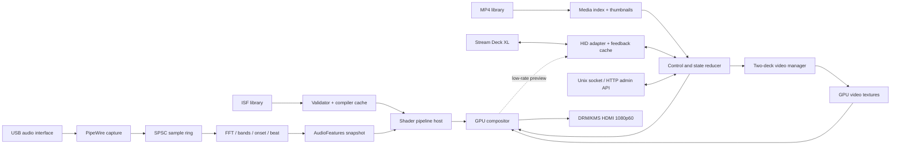

# Target Architecture

## Design summary

Use a modular Rust monolith with explicitly owned worker threads. Keep audio, video, rendering, control, and Stream Deck communication in one process initially. This minimizes latency and deployment complexity while retaining replaceable interfaces.



## Thread and ownership model

| Thread | Owns | May block? | Prohibited work |
|---|---|---:|---|
| Audio callback | PipeWire stream callback | No | allocation, locks, FFT, logs, JSON |
| Analyzer | FFT plan, feature history, beat tracker | Only waiting on ring | disk, GPU calls |
| Render | GPU device, render graph, texture pool, presentation | Only GPU synchronization/vblank | disk, shader compile, HID, JSON |
| Video workers | demuxers, decoders, preroll state | Yes, bounded | direct presentation/state mutation |
| Control runtime | reducer, config, command routing, API | Yes | GPU ownership |
| Stream Deck | HID handle and key-image cache | Yes | video decode, thumbnail extraction |
| Index workers | media probing, thumbnail creation, shader compile jobs | Yes | live render mutation |

Use bounded SPSC queues for single-producer real-time streams and bounded MPSC queues for commands/events. Coalesce high-rate `SetParameter` commands by target. Publish state and audio via double-buffered immutable snapshots.

## Runtime component boundaries

### Control and state reducer

The reducer is the authority for desired state. Device adapters translate input into domain commands; they never mutate render/video state directly. Each accepted command increments a state revision and produces zero or more effects for workers.

### Video manager

Manage deck A and deck B:

- visible deck continues decoding;
- hidden deck prepares the next clip;
- activation occurs only after a presentation-ready frame exists;
- transitions reference two stable source handles;
- looping resets timestamps and prerolls before the visible boundary when necessary;
- clips are not all kept decoding simultaneously.

The media profile should prefer MP4/HEVC Main 8-bit 4:2:0 at constant 60 fps. Short GOPs improve seeking and loop response. H.264 is permitted but marked software-decode in the index.

### Shader host

The shader host consumes validated, precompiled assets. Each instance owns parameter values and declared persistent targets. The render thread receives already-created pipelines or performs controlled pipeline installation at a frame boundary; it never parses JSON or invokes a compiler.

Audio data reaches shaders through:

- one aligned scalar uniform block;
- one `R32F`, width 256, height 1 spectrum texture;
- an active-bin count;
- edge-safe normalized sampling.

### Compositor

Normalize video and shader sources to linear RGBA textures. The initial render graph is:

```text
decoded YUV -> color conversion -> source texture
ISF passes ---------------------> source texture
sources -> transform/crop -> blend/key -> master output conversion -> scanout
```

Initial modes: alpha, additive, multiply, screen, luma key, and chroma key. Blending occurs in linear light. Color metadata must travel with decoded frames so YUV matrix/range and transfer conversion are explicit.

### Stream Deck adapter

The adapter consumes state snapshots and emits semantic `ControlEvent`s. It maintains a content hash per key and only writes changed images. Priority order:

1. press/release acknowledgement and blackout/error state;
2. active clip/shader selection;
3. parameter values;
4. thumbnails;
5. decorative meters/animation.

## Backend decision gate

The production target is wgpu/Vulkan, but the first Pi-native compositor spike must compare:

1. GStreamer decoded frame -> wgpu/Vulkan texture -> blend -> DRM/KMS;
2. GStreamer decoded frame -> EGLImage/GLES texture -> blend -> DRM/KMS.

Select raw GLES/EGL if wgpu requires sustained CPU copies or lacks robust DMA-BUF import on the deployed stack. Select raw Vulkan only if both higher-level paths fail a measured requirement.

## Failure behavior

- Audio unplug: decay features to zero; keep render/video running; reconnect asynchronously.
- Stream Deck unplug: keep output and state; reconnect and replay current page.
- Invalid shader: keep the previous shader and report diagnostics.
- Late video preroll: keep the current source visible; never switch to an empty frame.
- Queue overflow: retain the latest parameter value; never block a real-time producer.
- GPU device loss: rebuild from cached asset/state descriptions; allow systemd restart if recovery fails.
- Thermal overload: expose temperature/frame metrics and permit automatic internal shader-scale reduction.

