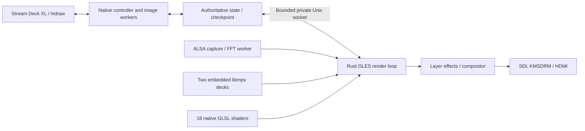
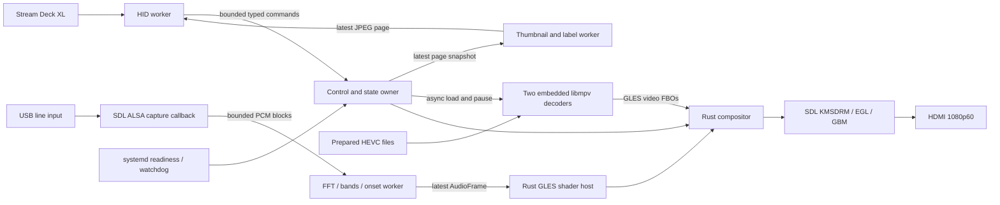

# Native appliance architecture and research

## Implementation update: controller fault isolation

The current implementation supersedes the initial single-process scaffold below. The USB controller is a separate Rust executable with no graphics/decoder dependencies. The renderer remains one Rust graphics application with embedded libmpv and audio workers. Both are supervised separately by systemd. This is an intentional reliability revision to the original blueprint.



Nine visual pages and their clip/shader/layer controls are migrated. Native shaders compile at startup; an invalid preset is disabled without terminating the controller. Video and shader layers have independent 24-effect selection and amount controls, eight blend modes, opacity, BPM/tap, speed and HUD. The next clip is warmed, audio reconnects, and desired state survives process restart. Consult `engine/README.md` and source for current runtime/API behavior; the following research retains the initial rationale and identifies broader ISF work not yet implemented.


Research checked 2026-10-03. This is the design authority for `codex/native-mpv-core`; historical plans are evidence, not runtime dependencies. “MVP” in the request is interpreted as **mpv**. The user has approved re-encoding the library to HEVC.

## 1. What went wrong architecturally

The original `rpi-vj-architecture.md` explicitly called for a single Rust process with multiple worker threads, native shader rendering, audio ring buffers and HID. The deployed `docs/original/ARCHITECTURE.md` instead describes Chromium owning video, graphics, audio and controller access. `scripts/appliance/launch-renderer.sh` in the parent revision still launches Chromium inside Cage. Lite OS removed the desktop dependency but retained the browser dependency.

That proves an architecture mismatch; it does not establish the root cause of every field failure without the corresponding logs. The old root Rust prototype is also insufficient: it spawns mpv as a separate process, uses unbounded control queues, writes all queued LCD images before polling buttons, and marks a clip active when the load command is sent. None of those properties establish show readiness.

The new build selects only `engine/`. Historical browser assets remain in Git for comparison and content migration but are not linked, served, launched or needed by the native application. No browser fallback is permitted. A missing decoder, GPU or controller produces explicit degraded/failure state, never a browser launch.

## 2. Engine selection

| Candidate | Verified upstream scope | Decision for this appliance |
|---|---|---|
| [Varda](https://github.com/im-knots/varda) | Native Rust VJ application with FFmpeg video, GLSL/ISF-style shaders, broad routing and output support; Linux source build described | Useful reference for routing and shader metadata. Too broad to adopt wholesale for a minimal clip appliance; Linux support alone is not Pi aarch64/KMS certification. Verify build and GPU requirements before reusing any module. |
| [audiovis](https://github.com/DatanoiseTV/audiovis) | Single-binary Rust audio visualizer; upstream describes headless ARM operation, native ISF generators and optional web control | Strong reference for constrained native visualizers and modulation. Its published tiny-ARM claims are not evidence of 1080p60 video compositing on Pi 5. Do not import its web/control/runtime surface into the appliance. |
| [nannou](https://github.com/nannou-org/nannou) | Rust creative-coding framework | Useful prototyping ecosystem. Does not provide the complete decoder/HID/boot recovery contract; adopting it adds a framework without removing the central appliance integration work. |
| [wgpu-native](https://github.com/gfx-rs/wgpu-native) | Native C API built on wgpu-core | Viable if choosing a C++/WGSL/Vulkan architecture. It is not a video player or appliance host. A Rust app can use wgpu directly; neither requires a browser. Defer because sharing libmpv's supported GL render path with GLES avoids cross-API texture import complexity. |
| [ISF specification](https://github.com/mrRay/ISF_Spec) | JSON metadata plus GLSL, including image, audio and audioFFT inputs | Adopt an explicitly bounded content profile after the basic native path passes hardware gates. ISF is a format, not a performance or host-compatibility guarantee. |
| [libmpv](https://github.com/mpv-player/mpv) | Mature video demux/decode/playback engine with an embedding render API | Selected as an in-process library. Rust owns output and compositing. No mpv subprocess and no competing DRM owner. |

The old report said Varda and audiovis could not be located. Both repositories are publicly accessible now; that older assessment must not be reused. The survey above is source/documentation evaluation, not a claim that any candidate has been benchmarked here. Record pinned revisions and review license notices before copying upstream code; this implementation does not vendor either application.

### Graphics API and shader language

Use **GLES 3.0 / GLSL ES 300** for the baseline, with SDL2 KMSDRM creating EGL/GBM presentation on the Pi. Rust `glow` owns textures, FBOs and shader programs. Query the installed driver's actual capabilities rather than relying on the brief's GLES 3.2 assumption. [Mesa's V3D documentation](https://docs.mesa3d.org/drivers/v3d.html) is the driver reference; exact capabilities depend on the installed image. Vulkan support does not make GLSL source, ISF metadata and WGSL interchangeable.

WGSL with wgpu/Vulkan is a defensible future backend if measurements justify it. It is not selected now because libmpv's documented GPU render interface is OpenGL, and a Vulkan compositor would need another proven import/copy boundary. C++ provides no inherent performance advantage for these GPU shaders; use C/C++ only where an existing native library supplies functionality more reliably than a rewrite.

The baseline compiles one built-in GLSL shader and a fused compositor at startup. There is no live compilation, dynamic ISF loading, feedback buffer graph, or full ISF compliance yet. The next host profile should explicitly support float/bool/long/color/point2D/image/audio/audioFFT, TIME/TIMEDELTA/FRAMEINDEX/RENDERSIZE, bounded pass counts and persistent ping-pong targets. Reject unsupported extensions at preparation time. Do not promise all desktop ISF shaders run by renaming uniforms.

### libmpv ownership and threading

One main thread owns SDL, the current GLES context, two libmpv render contexts and all GPU resources. libmpv owns its internal decode workers. All playback commands are asynchronous; event polling uses zero timeout. Callbacks perform no work. The GL context stays alive until both mpv render contexts and all renderer resources are freed. These constraints follow the [render API](https://github.com/mpv-player/mpv/blob/master/include/mpv/render.h), [GL interop contract](https://github.com/mpv-player/mpv/blob/master/include/mpv/render_gl.h), and [client API](https://github.com/mpv-player/mpv/blob/master/include/mpv/client.h).

Advanced render control is deliberately disabled in this baseline. Enabling it is a separate change requiring proof of callback servicing and multi-context teardown ordering. One process reduces coordination and deployment complexity; it also means a fatal native-library crash can take down the whole engine. systemd handles process recovery. Rust does not make GPU drivers or libmpv infallible.

## 3. Video and HEVC preparation

[Raspberry Pi's documentation](https://github.com/raspberrypi/documentation/blob/master/documentation/asciidoc/computers/config_txt/codeclicence.adoc) identifies HEVC hardware decode on Pi 5. Do not budget H.264 as hardware-decoded. Standardize prepared assets on HEVC Main 8-bit, 4:2:0, 1080p60, no audio, a closed GOP and an initial random-access frame. Start with GOP 30/no B-frames; measure bitrate/storage and switch latency before considering all-intra. MP4 is a container, not a decoder choice.

`engine/tools/prepare_media.py` uses [FFmpeg/libx265](https://ffmpeg.org/ffmpeg-codecs.html#libx265), validates output metadata, decodes the complete result, generates a small thumbnail, and writes a new show manifest only after success. It runs offline, preferably on a workstation. It does not rewrite originals or transcode during a show. HDR source conversion needs an explicit tone-mapping/color policy before such assets enter the qualified library; the baseline is SDR.

**Hardware availability and application support are different gates.** The exact kernel, FFmpeg, mpv, Mesa and EGL/DRM combination must expose the HEVC decoder to embedded libmpv. A command-line mpv success is insufficient. The baseline checks `hwdec-current` before a candidate becomes active. It currently uses `auto-safe`; if the image needs a different supported decoder selection, qualify and pin it instead of adding software fallback. Hardware decode may still incur frame copies; measure copy cost and actual decoder utilization. A property string alone is not a performance certificate.

### Trigger semantics

Two decks provide an active decoder and a candidate. Keep the active texture/output until the candidate has loaded, rendered and passed the decoder gate. Rapid requests coalesce to the newest desired clip, with a generation number preventing stale completion from changing “playing” feedback. Loading failures/timeouts leave the previous output intact. This baseline uses hard cuts, not video-to-video crossfades.

On-demand loading is implemented. Guaranteed instant switching is **not** implemented. A production extension must prepare a bounded hot set: pre-open the next selected clip, decode/render its first frame into standby, then promote at vblank. Do not keep 28 simultaneous 1080p decoders merely because there are 28 clip keys. Budget two decoder instances first; prove simultaneous HEVC throughput, memory, surface lifetime and thermal behavior on the Pi. Warm media cache alone is not decoded-frame readiness.

Proposed acceptance targets, not measured results: prepared trigger-to-first-present p95 <= 50 ms and p99 <= 100 ms; cold loads separately reported; controller input processing p99 <= 10 ms excluding USB transfer/device latency; page repaint p95 <= 250 ms with prepared 96px images. If the two-deck decode path cannot meet the target, reduce warm-set requirements or change the decoder integration based on evidence.

## 4. Audio DSP

Target 48 kHz stereo float capture, 512-frame hops (10.67 ms), 2048-sample Hann windows (42.67 ms), and 128 log-spaced display bins. “128 bins” is the shader output resolution; it does not mean a 256-sample FFT with poor bass resolution. Bass resolution is about 23.44 Hz. Window/hop latency is part of the visual response budget.

ALSA through SDL is the minimal appliance capture path; PipeWire can be a separately qualified SDL audio backend where routing flexibility is needed. Select the USB interface by a stable name/identity, not a changing numeric card index. Capture copies fixed blocks into an eight-slot bounded mailbox using nonblocking sends. Overflow increments a counter; no file/network operations, FFT or GPU calls occur inside the capture callback. The current crossbeam mailbox is bounded and nonblocking at the API level; it is not a hard real-time scheduling proof.

Analysis removes DC, applies the window, performs the FFT with preallocated work/scratch buffers, and aggregates band power. Band boundaries: bass 30–250 Hz, mid 250–4000 Hz, treble 4000–16000 Hz. Combine left/right power, not signed waveforms, for stable reaction to anti-phase stereo content. Normalize against a documented input calibration; avoid aggressive automatic gain that makes quiet noise flash at full brightness.

Positive spectral flux in roughly 40–8000 Hz supplies onset detection, gated by RMS and an adaptive running threshold. A ~192 ms refractory period suppresses repeated triggers on the same transient. An onset is not a stable BPM/beat tracker; future tempo estimation should use onset-history autocorrelation plus confidence/hysteresis, not label every transient a musical beat.

Attack/release envelopes use `alpha = 1 - exp(-hop_seconds / tau)` with 15 ms attack and 180 ms release. The onset pulse decays separately. A latest-only `AudioFrame` mailbox prevents feature backlog. After 250 ms without an audio update the renderer uses silence. Disconnect/reconnect supervision, input clipping meters and calibration are remaining appliance work.

### Shader bindings

`AudioFrame` contains bass, mid, treble, volume, onset, sequence and `[f32; 128]` spectrum. Rust binds `u_bass`, `u_mid`, `u_treble`, `u_volume`, `u_beat_onset` as floats, plus `u_time`. The spectrum is a 128x1 R32F texture bound to `u_spectrum`, sampled with normalized coordinates. Nearest sampling avoids requiring float-linear filtering support; an ISF adapter can implement interpolation explicitly.

Future ISF `audioFFT` inputs map to spectrum textures with declared channel/width semantics; `audio` inputs need a separate waveform buffer, not the FFT magnitude texture. Reserve conventional ISF uniforms and translate sampler helpers properly. Audio features are engine extensions, not names universally required by ISF. Cache uniform locations and use a uniform block when adding more shaders; avoid querying/uploading redundant state on every frame in the qualified renderer.

## 5. Modules and scheduling



The state owner runs in the main/render loop, avoiding another mandatory round-trip for a trigger. Device image preparation and USB transfers are independent of rendering. HID reads occur between every image report, so a 32-key repaint does not monopolize input handling. LCD images are status/thumbnail snapshots, not live 60fps video. Bind each physical key to its fully transmitted image until the next image finishes; a partly repainted page must never launch an unseen clip.

The blend pass supports alpha, additive and soft luma key. The implemented baseline uses an SDR code-value blend; linear-light blending, correct HDR-to-SDR conversion, adjustable key color/threshold and premultiplied alpha conventions are future work. Keep video at 1080p output while permitting shader rendering at 960x540 if GPU measurements require it; resolution scaling is a planned quality policy, not yet implemented.

Do not assign SCHED_FIFO to all workers. Under ordinary Linux scheduling first measure render deadlines, USB latency, capture overflows and thermal throttling. If audio capture needs elevated scheduling, grant only that narrow capability. Storage import/transcoding never shares the performance critical path during shows.

## 6. Scaffold and contracts

```text
Cargo.toml                    # only engine is a root workspace member
engine/
  src/main.rs                 # strict CLI, show loading, native entry point
  src/show.rs                 # local media manifest validation
  src/control.rs              # typed commands, page state, generations
  src/audio.rs                # reusable FFT analysis and fixtures
  src/native/mod.rs           # render loop, candidate state, readiness
  src/native/mpv.rs           # thread-bound libmpv ABI and RAII
  src/native/render.rs        # GLES programs, FBOs, blending
  src/native/capture.rs       # SDL callback, DSP worker, bounded queues
  src/native/deck.rs          # image worker, HID packets, visible-key bindings
  shaders/                    # GLSL ES 300 source, embedded at build time
  deploy/                     # native-only systemd and udev templates
  tools/prepare_media.py      # offline HEVC and thumbnail preparation
docs/native/                  # this decision and hardware acceptance gates
```

Core interfaces are actual Rust types: `Show::load`, `State::apply(Command)`, `State::presented(clip, generation)`, `Analyzer::process`, `AudioFrame`, `Mpv::{load,poll,render}`, `Renderer::draw`, `Deck::publish`. `State::presented` is called after the corresponding swap returns, not upon command submission. This is application presentation evidence; optical display latency still needs an external measurement.

Serializable command examples:

```json
{"type":"TriggerClip","clip":7}
{"type":"Page","delta":1}
{"type":"SelectShader","enabled":true}
{"type":"SetBlend","mode":"Additive","opacity":0.35}
{"type":"Blackout","enabled":true}
```

These are typed in-process contracts, **not an implemented socket API**. A later local Unix socket should use a versioned envelope `{version, request_id, command}`, a bounded message length, peer credentials, replies `{request_id, accepted, error}`, and separate `ClipPresented` events with generation and monotonic time. Never use JSON for PCM or per-frame audio updates. Proposed `UpdateAudioUniforms` is the fixed-size internal `AudioFrame`, with latest-wins semantics; there is no network exposure in this baseline. Dynamic `SelectShader {id}` follows only after the content loader exists; today selection is a built-in on/off toggle.

## 7. Reliability is a release property

Read [QUALIFICATION.md](QUALIFICATION.md). The root Rust tests demonstrate state and DSP behavior. They cannot certify GPU drivers, hardware HEVC decode, USB firmware, KMS seat permissions, boot ordering or power-loss behavior. Keep the branch labelled development until those gates pass on the actual Pi and actual media set. An eight-hour successful idle process is not equivalent to an eight-hour stress show with real output and controller input.
