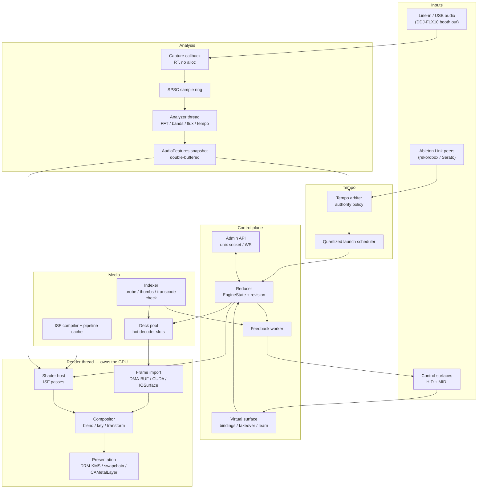

# Target Architecture

One Rust process. Explicitly owned worker threads. Platform variation confined to four crates. Everything else builds unchanged for aarch64-linux, x86_64-windows, and aarch64-darwin.

## 1. System view



## 2. Thread ownership

| Thread | Owns | May block on | Prohibited |
|---|---|---|---|
| Audio capture callback | platform capture stream | nothing | allocation, locks, logging, FFT, disk |
| Analyzer | FFT plans, feature history, tempo tracker | the sample ring only | disk, GPU, engine state |
| Link session | Ableton Link peer state | Link's own callbacks | GPU, disk, blocking on the reducer |
| Render | GPU device, render graph, texture pool, presentation | GPU sync / vblank | disk, shader compile, HID/MIDI, JSON, unbounded alloc |
| Frame import | decoded-frame handoff, external memory objects | decoder fences | render graph mutation |
| Decode workers (per deck) | demuxer, decoder, preroll | yes, bounded | presentation, state mutation |
| Control runtime | reducer, config, command routing, admin API | yes | GPU ownership |
| Surface input (one per device) | one MIDI/HID connection | blocking read with timeout | image encoding, state mutation, per-message allocation |
| Feedback worker | per-device feedback cache and diff | device write | GPU, decode, thumbnail extraction |
| Indexer | probing, thumbnails, shader compilation jobs | yes | live render mutation |

Bounded SPSC for real-time single-producer streams; bounded MPSC for commands and events. High-rate `SetParameter` commands coalesce by target path — the last value wins, the queue never grows. State and audio features publish as double-buffered immutable snapshots with a revision counter; the render thread reads the newest complete snapshot and never waits for a producer.

Do not give every thread real-time priority. On the Pi in particular, a runaway high-priority loop starves USB, PipeWire, and your own recovery paths.

## 3. Control plane

### Reducer

Single authority for desired state. Adapters (surfaces, admin API, scheduler) submit `EngineCommand`; the reducer validates, mutates `EngineState`, bumps the revision, and emits effects for workers plus `EngineEvent`s for observers.

Command acceptance is not visibility. The lifecycle, carried forward from the earlier contract work:

```
TriggerClip ─► CommandAccepted ─► ClipPrepared ─► ClipActivated
                     └─────────► CommandRejected
```

`ClipActivated` carries the actual presentation timestamp, so latency is measured from real data rather than asserted.

### Commands and events

```rust
#[derive(Debug, Clone, Serialize, Deserialize)]
#[serde(tag = "type", rename_all = "snake_case")]
pub enum EngineCommand {
    TriggerClip  { request_id: RequestId, deck: DeckId, clip: ClipId,
                   transition: TransitionSpec, quantize: Quantize },
    CueClip      { deck: DeckId, clip: ClipId },        // promote to a hot decoder slot
    StopDeck     { deck: DeckId, transition: TransitionSpec },
    SelectShader { request_id: RequestId, layer: LayerId, shader: ShaderId },
    SetParameter { target: ParameterPath, value: ParameterValue, ramp_ms: u32 },
    SetLayerOpacity { layer: LayerId, value: f32, ramp_ms: u32 },
    SetBlendMode { layer: LayerId, mode: BlendMode },
    SetBank      { surface: SurfaceId, region: RegionId, bank: u32 },
    SetQuantize  { value: Quantize },
    TapTempo     { at_ns: u64 },
    SetTempoAuthority { source: TempoSource },
    Blackout     { enabled: bool },
}
```

`Quantize` is `Off | Beat | HalfBar | Bar | Phrase(u8)`. `TransitionSpec` is `{ kind: Cut | Crossfade | Dip | Wipe, duration_ms }`.

`SetBank` is a control-plane concept, not a device concept — a device's scroll window is engine state, so the feedback worker can light the right pads and a second device can observe the first device's page.

### Admin API

Unix domain socket on the Pi; localhost WebSocket on desktop. Versioned JSON. Low-rate only: configuration, show load/save, MIDI learn, diagnostics, metrics. Per-frame telemetry does not go over JSON. This is also the seam for a future web UI or a phone remote.

## 4. Media pipeline

### Clip index

Built at startup and on demand, never during a trigger. Per clip: path, codec, profile, dimensions, frame rate, duration, pixel format, colour primaries/matrix/range/transfer, GOP structure, first random-access point, available renditions per media tier, and a device-ready thumbnail set (one encoded buffer per bitmap surface size in use).

Invalid clips become disabled keys with an error colour. They never crash the service and never blank the output.

### Deck pool and hot decoder slots

Rather than a fixed two-deck model, decks are a pool sized by platform tier:

| Tier | Visible decks | Hot decoder slots | Rationale |
|---|---|---|---|
| Appliance (Pi 5) | 2 | 4 | One HEVC block; hidden preroll costs real bandwidth |
| Portable (M2 Pro) | 4 | 12 | VideoToolbox handles several streams comfortably |
| Workstation (3090) | 8 | 32 | NVDEC is not the bottleneck |

Slot promotion is explicit (`CueClip`, and any clip visible on a control surface's current page is implicitly cued if budget allows) plus recent-use eviction. A trigger against a hot slot activates at the next vblank. A trigger against a cold clip starts a decode, keeps the current source visible, and reports a `degraded_latency` metric — it never shows black.

Loop boundaries reset timestamps and preroll ahead of the boundary. Whether the loop seam needs head/tail buffering is decoder-dependent and is settled by Gate A per platform.

### Transitions

Two source handles are always stable during a transition. Crossfade, dip-to-colour, and a small wipe set are compositor operations on two live sources — never a decoder-level operation.

## 5. Shader host

ISF 2 is the content and metadata contract, restricted to an embedded profile: fragment generators and filters; `float`, `bool`, `long`, `color`, `point2D`, `event`, `image`, `audioFFT` inputs; `TIME`, `TIMEDELTA`, `FRAMEINDEX`, `RENDERSIZE`, `PASSINDEX`; single pass plus bounded multipass (max 4 passes on Appliance, 8 on desktop tiers); persistent buffers; intermediate scale restricted to 0.25 / 0.5 / 1.0; no desktop-only extensions, no unbounded loops, no runtime-sized resource creation.

Compilation pipeline, run by the indexer:

```
.fs / .isf file
  → parse JSON header
  → validate against the embedded profile and the target tier's resource budget
  → inject ISF built-ins, macros, and this project's audio bindings
  → shaderc/glslang → SPIR-V
  → naga → backend (SPIR-V on Vulkan, MSL on Metal, DXIL if D3D12 is used)
  → cache keyed by (source hash, profile version, backend, tier)
```

A compile failure produces diagnostics and leaves the currently live shader running. Compilation never occurs on the render thread and never occurs on a live trigger, on any platform.

### Shader ABI

Every project shader may rely on this block. It is the earlier research's contract, extended:

```glsl
uniform float u_time;
uniform float u_time_delta;
uniform vec2  u_resolution;
uniform int   u_frame_index;

uniform float u_bass;             // 0..1, dual-EMA smoothed
uniform float u_mid;
uniform float u_treble;
uniform float u_volume;           // RMS, noise-floor normalised

uniform float u_beat_onset;       // impulse, 80-140 ms visual decay applied by the host
uniform float u_beat_phase;       // 0..1 within the current beat
uniform float u_bar_phase;        // 0..1 within the current bar
uniform float u_bpm;              // 0 until a usable estimate exists
uniform float u_beat_confidence;  // 0..1

uniform sampler2D u_fft;          // R32F, 1 x N, log-spaced, low→high left→right
uniform int       u_fft_bins;     // active bins in u_fft
uniform sampler2D u_waveform;     // R32F, 1 x N, recent PCM
```

Ranges are contractual. `u_bpm` is zero rather than garbage when unresolved. `u_beat_confidence` decays smoothly through breakdowns rather than snapping — a BPM-locked effect must not visibly stutter when the DJ drops the beat out.

Delivery: one aligned scalar uniform block plus two small textures updated once per frame. A 256 × 1 R32F texture is 1 KB; this is not a cost worth optimising.

## 6. Audio analysis

```
platform capture (48 kHz stereo f32, quantum/buffer 256)
  → DC removal, optional input gain
  → overlap accumulator (2048-sample window, 256 or 512 hop)
  → Hann window
  → real FFT (realfft/rustfft)
  → power spectrum, log magnitude
  → perceptual log aggregation to 128 bins (capacity 256)
  → band energies (bass 20–250, mid 250–4k, treble 4k–16k) + RMS
  → noise-floor and upper-envelope normalisation
  → dual-rate EMA:  alpha = 1 - exp(-dt / tau)
                    tau_attack  ≈ 10–20 ms
                    tau_release ≈ 150–300 ms
  → positive spectral flux vs rolling median + MAD, 100–160 ms refractory
  → tempo/phase tracker with confidence
  → AudioFeatures snapshot (fixed layout, no allocation)
```

Two rules that prevent the two classic failures: dual-rate EMA (symmetric smoothing causes the flicker you are trying to avoid), and never normalising a spectrum by its own maximum (silence would look active).

```rust
#[repr(C)]
#[derive(Clone, Copy)]
pub struct AudioFeatures {
    pub sequence: u64,
    pub captured_at_ns: u64,
    pub rms: [f32; 2],
    pub volume: f32,
    pub bass: f32,
    pub mid: f32,
    pub treble: f32,
    pub onset: f32,
    pub beat_trigger: u32,
    pub beat_phase: f32,
    pub bar_phase: f32,
    pub bpm: f32,
    pub beat_confidence: f32,
    pub spectrum_len: u32,
    pub spectrum: [f32; 256],
    pub waveform: [f32; 256],
}
```

## 7. Render graph

```
per decoded frame:  imported texture (YUV or BC-compressed)
                      → colour convert to linear RGBA  → source texture

per shader layer:   ISF pass 1..N (bounded, pooled targets)
                      → source texture

composite:          for each layer in z-order
                      transform / crop
                      → blend( alpha | additive | multiply | screen
                             | luma-key | chroma-key )
                    → master opacity, master colour
                    → output transfer conversion
                    → presentation
```

Blending happens in linear light. Colour metadata travels with each decoded frame so the YUV matrix, range, and transfer conversion are explicit rather than guessed. Texture and render-target allocation goes through a pool; the render thread performs no steady-state heap allocation.

Presentation per platform is the only part of this graph that varies — see [`04-PLATFORM-BRANCHES.md`](04-PLATFORM-BRANCHES.md).

## 8. Failure behaviour

| Failure | Response |
|---|---|
| Audio device unplugged | Decay features to zero over ~1 s, keep render and video running, reconnect asynchronously. Do not zero `u_bpm` abruptly. |
| Control surface unplugged | Keep output and state. On reconnect, re-run device init (Programmer Mode, etc.) and replay the full feedback frame. |
| Link peer lost | Fall back to the next tempo authority per policy; hold last known BPM with decaying confidence. |
| Shader compile failure | Keep the previous shader live; surface diagnostics through the admin API and the surface error colour. |
| Cold trigger / late preroll | Keep the current source visible. Report degraded latency. Never present an empty frame. |
| Queue overflow | Retain the newest parameter value; never block a real-time producer. |
| Decoder stall | Freeze the last good frame on that deck, mark the deck faulted, attempt restart. |
| GPU device loss | Rebuild from cached asset and state descriptions; allow supervisor restart if recovery fails. |
| Thermal throttle (Pi) | Expose temperature and frame metrics; permit automatic internal shader-scale reduction behind a config flag. |

## 9. Observability

Counters: triggers, cold triggers, missed deadlines, dropped frames, decoder restarts, surface reconnects, audio xruns, ring overruns, command coalesces and drops, feedback messages per device.

Gauges: per-core CPU, GPU frame time, presentation interval, resident memory, hot slot occupancy, analyzer duration, SoC temperature and throttle flags, Link peer count and phase error.

Percentiles, not means: frame time p50/p95/p99/p99.9, HID-to-photon p50/p95/p99.

An in-memory flight recorder holds the last few seconds of transitions and timing samples and is flushed only from a non-real-time thread after a fault.
