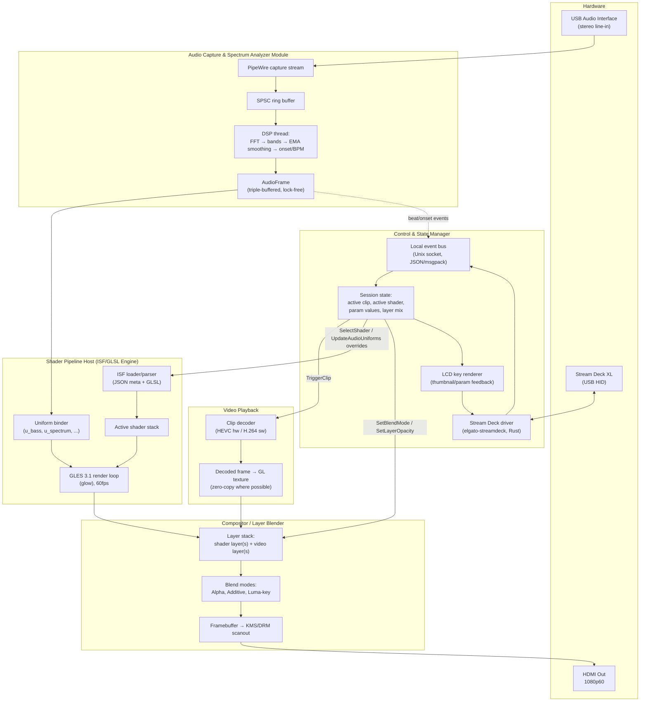

# RPi5 VJ Performance System — Architecture & Research Report

> **Supplementary exploration.** This report includes shader/engine research beyond the currently implemented scaffold. For implementation status and the staged plan, start with [`docs/HANDOFF.md`](docs/HANDOFF.md).

**Target hardware:** Raspberry Pi 5 (8GB recommended), Raspberry Pi OS Bookworm 64-bit Lite, VideoCore VII / V3D 7.1 GPU, Stream Deck XL, USB audio interface (stereo line-in from DJ mixer).

**Scope:** open-source engine survey, audio-reactive shader uniform design, real-time audio DSP architecture, system architecture diagram, and a production-ready codebase scaffold.

---

## 0. Executive Summary

| Decision | Recommendation |
|---|---|
| Render API | **OpenGL ES 3.1** as the primary/only target for v1. RPi5's V3D driver is Khronos-conformant at **GLES 3.1**, not 3.2 — see §0.1. |
| Shader standard | **ISF (Interactive Shader Format)** as the authoring/interchange format, translated to a custom minimal-runtime rather than adopting a full third-party ISF host. |
| Engine base | **Do not fork a VJ framework wholesale.** Build a small custom Rust render core (~3–5k LOC) using `glow` (GLES bindings) or `wgpu` in its GLES backend, informed by the ISF spec and glslViewer's audio-texture approach. Rationale in §1. |
| Video playback | Software-decoded H.264 via `ffmpeg`/GStreamer on the CPU, or re-encode the loop library to **HEVC** to use RPi5's hardware decode block. RPi5 dropped H.264 hardware decode — see §0.2. This is the single biggest hardware gotcha in the whole brief. |
| Audio pipeline | **PipeWire** capture → ring buffer → windowed FFT (`realfft`/`rustfft`) → log-banded bass/mid/treble + spectral-flux beat detection → dual-EMA smoothing → shared-memory uniform block consumed by the render thread. |
| Stream Deck | **Rust `elgato-streamdeck` crate** (actively maintained, HIDAPI-based, works headless on Linux) rather than the Python library, so it lives in the same process/IPC domain as the rest of the engine. |
| IPC / control | In-process for the core loop (single binary, multi-threaded, lock-free ring buffers between audio/render/control threads); a local Unix-domain-socket JSON/msgpack event bus for external control surfaces (OSC, MIDI, a future web UI) so Stream Deck logic isn't hard-wired to the renderer. |

### 0.1 Correcting a hardware assumption

The brief states VideoCore VII supports "OpenGL ES 3.2 / Vulkan 1.3." Current sources (Mesa docs, Phoronix, Raspberry Pi forums, Aug 2026) show:

- **V3D (GLES driver): Khronos-conformant at OpenGL ES 3.1**, not 3.2. Some GLES 3.2 *extensions* are exposed piecemeal, but the driver is not 3.2-conformant, so targeting 3.2 core features is unsafe.
- **V3DV (Vulkan driver): Vulkan 1.3 conformant** (Mesa 24.3, confirmed by Khronos adopter list) — this part of the brief is accurate.
- Practical implication: design shaders and the render core against **GLES 3.1 core**, and treat Vulkan/V3DV as an optional, higher-effort backend for later (younger driver, thinner tooling/debugging ecosystem on RPi than GLES).

### 0.2 RPi5 has no H.264 hardware decoder

This matters directly for "instant triggering of local 1080p60 MP4 loops":

- RPi4 had a hardware H.264 decode block; **RPi5 removed it**. RPi5's hardware video block only accelerates **HEVC/H.265 decode**; H.264 must be software-decoded on the CPU.
- The RPi5 CPU (quad-core Cortex-A76 @ 2.4GHz) can software-decode 1080p60 H.264 in real time for a *single* stream with headroom, but decoding while simultaneously running a 60fps shader compositor and driving a Stream Deck adds contention risk, especially for multiple pre-buffered clips.
- **Recommendation:** standardize the VJ loop library on **HEVC (H.265)** where hardware decode applies, or on an intra-frame-only / low-decode-cost codec (Motion JPEG, or H.264 with a low GOP/all-I-frame encode) to guarantee frame-accurate instant seeking regardless of decode path, and benchmark both against your actual clip set before committing.

---

## 1. Open-Source Engine & Shader Research

### 1.1 Repos named in the brief

Two repositories named in the request could not be located and should be treated as unverified/likely misremembered rather than assumed to exist:

- `im-knots/varda` — no matching public repository found under that GitHub account (the account's visible public work is unrelated, e.g. an AI-agent dialogue project). If you have a private link or a different spelling, share it and it can be re-evaluated.
- `DatanoiseTV/audiovis` — not found in that account's public repo list either (that account's public work centers on embedded synth/audio firmware and streaming tools, not a VJ/ISF host).

Rather than guess at what they might have been, below is a survey of real, currently-maintained candidates that do fit the stated goal (fastest path to production on VideoCore VII, ISF/GLSL-first).

### 1.2 Candidate survey

| Project | Language/API | Linux aarch64 fit | Verdict |
|---|---|---|---|
| **ISF spec + shader corpus** (`vidvox/isf`, `mrRay/ISF_Spec`, `Vidvox/ISF-Files`) | JSON+GLSL spec, not a runtime | N/A — it's a format, not an engine | **Adopt as the shader authoring format.** Hundreds of existing ISF shaders (VDMX/Resolume/TouchDesigner-compatible) become usable content immediately if you write a compliant loader. |
| **glslViewer** (`patriciogonzalezvivo/glslViewer`) | C++, GLES/GL, CLI | Builds and runs on RPi; has `--audio <device>` flag that feeds an audio texture (spectrum + waveform rows) into shaders | Good **reference implementation** for how to wire live audio into a GLSL texture uniform cheaply; too CLI/single-shader-oriented to be the whole engine, but worth vendoring its audio-texture code path. |
| **vvisf-gl** (`mrRay/vvisf-gl`) | C++, cross-platform ISF host (the reference ISF runtime) | Explicitly supports Raspberry Pi via GLFW, but its own docs flag RPi GL support as "not as robust as desktop/mobile" | The most spec-complete open ISF host; usable as a **library dependency** if you want strict ISF conformance rather than a hand-rolled subset. Worth a spike before committing to a custom loader. |
| **projectM** (`projectM-visualizer/projectm`) | C++, Milkdrop-compatible, packaged for aarch64 (Arch Linux ARM), has a working community RPi5/Bookworm build (`kholbrook1303/RPI5-Bookworm-ProjectM-Audio-Receiver`) | Proven on RPi5 Bookworm today | Great for the **preset-visualizer layer** (thousands of existing Milkdrop presets) but Milkdrop's preset format is not ISF/GLSL-ES-native and its audio-reactivity model is closed inside the library — harder to expose custom uniforms like `u_beat_onset` to your own compositor. Consider as a bundled "preset pack" source, not the core engine. |
| **nannou** (Rust) | Rust, wgpu-backed | Depends on `wgpu`'s GLES/Vulkan backend maturity on VideoCore; no confirmed RPi5 production reports found | Attractive for a Rust codebase, but adds a heavyweight creative-coding framework (windowing, UI, audio abstractions) you'd fight rather than use for a VJ-specific compositor. Treat `wgpu-native` (the underlying crate) as the real building block, not `nannou` itself. |
| **wgpu-native / wgpu (Rust)** | Rust, targets Vulkan/GLES/Metal/D3D via one API, WGSL shaders | GLES backend exists and is the realistic RPi5 path today; Vulkan backend usable once V3DV is validated for your workload | Good **long-term** portability bet (write once, run GLES now / Vulkan later), at the cost of a translation layer between your audio uniforms and WGSL, and of needing a GLSL→WGSL step if you want to reuse the ISF/GLSL shader corpus. |

### 1.3 Recommendation

Build a small custom render core in Rust on top of **`glow`** (thin, unsafe-free GLES/GL bindings, no framework baggage) targeting **GLES 3.1**, using the **ISF JSON+GLSL convention** for shader files (so the shader corpus and mental model are reusable), and borrowing glslViewer's audio-texture technique for uniform delivery. This avoids fighting a general-purpose creative-coding framework (nannou) or a closed preset engine (projectM) for a VJ-specific requirement (frame-accurate clip triggering + live compositing + hardware control surface), while still giving you a credible upgrade path to `wgpu`/Vulkan/WGSL later since the audio-uniform and compositor logic in §3–§4 doesn't depend on the graphics API.

If team velocity matters more than long-term portability, evaluate **vvisf-gl** as a vendored dependency first (1–2 day spike) — if its RPi GL path is solid enough in practice, it saves writing an ISF parser/loader from scratch.

---

## 2. Audio-Reactive GLSL Uniforms

### 2.1 Uniform contract

Standardize every shader (custom or ISF-imported) against this uniform block, delivered once per render frame by the Control & State Manager:

```glsl
// Standard audio-reactive uniform block — all shaders may assume these exist.
uniform float u_time;          // seconds since engine start
uniform vec2  u_resolution;    // output resolution in pixels

// Smoothed, normalized [0.0, 1.0] band energies (see §3.3 for smoothing)
uniform float u_bass;
uniform float u_mid;
uniform float u_treble;
uniform float u_volume;        // overall RMS/loudness, normalized

// Beat/onset
uniform float u_beat_onset;    // impulse: 1.0 on the render frame a beat is detected, decays to 0.0
uniform float u_beat_confidence; // 0..1, running confidence in current detected BPM/phase
uniform float u_bpm;           // estimated BPM, 0 if unresolved

// Raw spectrum, for shaders that want more than 3 bands
uniform sampler2D u_spectrum;  // 1 x N texture (N=64..256 bins), R32F or R8, log-spaced
uniform sampler2D u_waveform;  // 1 x N texture, recent PCM samples for oscilloscope-style effects
```

This mirrors (and is a superset-compatible subset of) the pattern ISF already uses for audio inputs (`"TYPE": "audio"` / `"audioFFT"` image inputs in the ISF spec), so ISF shaders authored against `u_spectrum`-style textures port over with only a rename pass, and hand-written engine shaders get the richer `u_bass`/`u_beat_onset` convenience uniforms on top.

### 2.2 Delivery mechanism

- The audio thread (§3) writes band values and the spectrum/waveform arrays into a **triple-buffered, lock-free struct** (`AudioFrame`) at the audio callback rate (see §3.1).
- Each render frame, the render thread does a non-blocking read of the latest `AudioFrame`, uploads `u_spectrum`/`u_waveform` via `glTexSubImage2D` (cheap: a 256×1 R32F texture is 1KB), and sets the scalar uniforms.
- Decoupling audio-callback rate (driven by PipeWire quantum, typically 128–512 samples ≈ 2.7–10.7ms at 48kHz) from render rate (16.6ms @ 60fps) means the renderer always reads the freshest available analysis without blocking on audio I/O — critical for avoiding frame drops.
- `u_beat_onset` is written as a one-shot impulse by the DSP thread and exponentially decayed by the *renderer* (not the DSP thread) each frame it's consumed, so a shader author gets a clean instantaneous trigger without needing to implement decay themselves — but the source-of-truth onset event is also pushed onto the control event bus (§4) for non-shader consumers (e.g. Stream Deck LED flash on beat, or triggering a full clip cut on downbeat).

---

## 3. Audio DSP Pipeline Architecture

### 3.1 Capture

```
USB Audio Interface (stereo line-in)
        │  ALSA hw device
        ▼
   PipeWire graph
        │  pw-stream, capture node, 48kHz, F32 interleaved
        │  quantum: 256 samples (~5.3ms) — tune per USB interface's actual latency floor
        ▼
   Lock-free ring buffer (SPSC, e.g. `ringbuf` crate)
        ▼
   DSP thread (dedicated, real-time-priority if permissions allow via `RLIMIT_RTPRIO`/rtkit)
```

Use PipeWire (not raw ALSA) because Bookworm ships it as the default audio server, it gives you clean device hot-plug handling for the USB interface, and its quantum/latency controls are well documented and tunable per-client without root, unlike hand-rolled ALSA. Run the capture client as a **realtime-priority PipeWire stream** and pin the DSP thread with `sched_setscheduler`/rtkit to avoid dropouts fighting the render thread for CPU.

### 3.2 FFT / spectral analysis

- Window: 1024 or 2048-sample analysis window (trade latency vs. bass-frequency resolution — 2048 @ 48kHz gives ~23Hz/bin resolution, needed to resolve sub-bass/kick separately from low-mid).
- Windowing function: Hann, to control spectral leakage.
- FFT implementation: `realfft`/`rustfft` (pure-Rust, no external deps, SIMD-accelerated, good on ARM64/NEON) or `pffft` via FFI if you need the extra throughput margin — either is comfortably fast enough at these sizes at 48kHz on a Cortex-A76.
- Bin count for the shader-facing `u_spectrum` texture: 64–256 bins, **log-spaced** (perceptual/musical spacing) rather than the FFT's native linear bins — resample the linear FFT output into log bins before upload so visual response matches how a human perceives frequency content.

### 3.3 Band isolation & smoothing

```
raw FFT magnitude bins
   │
   ├─ bass band  = sum(bins mapped to ~20–250 Hz)   → normalize → EMA(attack_fast, release_slow) → u_bass
   ├─ mid band   = sum(bins mapped to ~250–4000 Hz) → normalize → EMA(...)                         → u_mid
   ├─ treble band= sum(bins mapped to ~4000–16000Hz)→ normalize → EMA(...)                         → u_treble
   └─ volume     = RMS(time-domain window)          → normalize → EMA(...)                         → u_volume
```

**Dual-rate EMA** (separate attack/release time constants) is the key anti-flicker technique: fast attack (~10–20ms time constant) so transients still feel punchy, slow release (~150–300ms) so the visual doesn't stutter between frames on noisy/borderline energy. This is standard in audio metering (VU-meter ballistics) and directly solves the brief's "without stutter or flickering" requirement — a single symmetric EMA (same attack/release) is the most common mistake and produces exactly the flicker being asked to avoid.

### 3.4 Beat/onset detection

- **Spectral flux onset detection**: compute the positive-only frame-to-frame difference in the magnitude spectrum, summed across bins (`flux[t] = Σ max(0, mag[t][k] - mag[t-1][k])`). This is a well-established, cheap, real-time-friendly onset detector.
- **Adaptive threshold**: compare `flux[t]` against a local moving average + a multiplier (e.g. threshold = mean(flux, last ~1s window) × 1.5), rather than a fixed threshold, so it self-adjusts to the mixer's overall gain/loudness instead of needing manual calibration per DJ set.
- Emit `u_beat_onset = 1.0` (impulse) when flux crosses the adaptive threshold and a minimum refractory period (~100ms, i.e. cap at ~600 BPM) has elapsed since the last onset, to prevent double-triggering on a single transient's energy spreading across adjacent frames.
- **BPM estimation** (`u_bpm`/`u_beat_confidence`): maintain an inter-onset-interval histogram/autocorrelation over a rolling ~4–8 second window; report a BPM only once confidence (histogram peak sharpness) clears a threshold, and decay confidence gracefully rather than snapping to 0/garbage on a quiet passage — DJ transitions and breakdowns should degrade `u_beat_confidence` smoothly, not zero out `u_bpm` abruptly (which would visually "flicker" any BPM-locked effect).

---

## 4. System Architecture



Module responsibilities:

- **Audio Capture & Spectrum Analyzer** — owns the PipeWire connection and DSP thread; the only module allowed to touch the sound card; publishes `AudioFrame` and pushes discrete beat/onset events to the control bus for non-shader consumers.
- **Shader Pipeline Host** — owns the GL context, shader compilation/hot-reload, and the ISF-compatible uniform binder; consumes `AudioFrame` read-only.
- **Video Playback** — owns clip decode (hardware HEVC path or software H.264 fallback), pre-buffering for instant-trigger latency, and exposes decoded frames as GL textures to the compositor.
- **Compositor/Layer Blender** — the only module that writes to the final framebuffer; composites N shader layers and M video layers with per-layer blend mode and opacity, then hands off to KMS/DRM for scanout (bypassing a desktop compositor entirely, since this is a dedicated single-app HDMI-out box — no X11/Wayland compositor overhead needed at runtime).
- **Control & State Manager** — the only module that talks to the Stream Deck; owns canonical session state; translates physical key presses into typed events (`TriggerClip`, `SelectShader`, `SetParam`, ...) on the local event bus, and renders LCD key thumbnails/feedback by pulling render-target snapshots or precomputed thumbnails from the other modules.

Threading model: 1 audio thread (realtime priority), 1 render thread (drives the GL context, vsync-paced), 1 control thread (Stream Deck HID polling + event bus), with all cross-thread communication via lock-free SPSC/MPSC channels — no module blocks another module's hot path.

---

## 5. Codebase Scaffold & API Spec

### 5.1 Directory structure (Rust workspace)

```
rpi-vj/
├── Cargo.toml                      # workspace root
├── crates/
│   ├── vj-audio/                   # Audio Capture & Spectrum Analyzer Module
│   │   ├── src/
│   │   │   ├── capture.rs          # PipeWire stream setup
│   │   │   ├── fft.rs              # windowing + FFT + log-band resampling
│   │   │   ├── bands.rs            # bass/mid/treble/volume extraction + dual-EMA smoothing
│   │   │   ├── onset.rs            # spectral flux, adaptive threshold, BPM estimation
│   │   │   └── frame.rs            # AudioFrame struct + triple-buffer publisher
│   │   └── Cargo.toml
│   │
│   ├── vj-shader/                  # Shader Pipeline Host (ISF/GLSL engine)
│   │   ├── src/
│   │   │   ├── isf/
│   │   │   │   ├── parser.rs       # ISF JSON metadata parser
│   │   │   │   └── loader.rs       # GLSL source assembly (ISF → GLES 3.1 fragment shader)
│   │   │   ├── gl/
│   │   │   │   ├── context.rs      # GLES context/EGL setup (KMS/DRM, no X/Wayland)
│   │   │   │   ├── program.rs      # shader compile/link, hot-reload watcher
│   │   │   │   └── uniforms.rs     # standard uniform binder (§2.1 contract)
│   │   │   └── stack.rs            # active shader layer stack, param overrides
│   │   └── Cargo.toml
│   │
│   ├── vj-video/                   # Video Playback module
│   │   ├── src/
│   │   │   ├── decode.rs           # ffmpeg/gstreamer bindings; HEVC hw / H.264 sw path
│   │   │   ├── pool.rs             # pre-buffered clip pool for instant-trigger latency
│   │   │   └── texture.rs          # decoded frame → GL texture upload
│   │   └── Cargo.toml
│   │
│   ├── vj-compositor/              # Compositor / Layer Blender
│   │   ├── src/
│   │   │   ├── layer.rs            # Layer struct, blend mode enum
│   │   │   ├── blend.rs            # alpha / additive / luma-key shader passes
│   │   │   └── scanout.rs          # KMS/DRM framebuffer output
│   │   └── Cargo.toml
│   │
│   ├── vj-control/                 # Control & State Manager
│   │   ├── src/
│   │   │   ├── streamdeck.rs       # elgato-streamdeck driver wrapper
│   │   │   ├── thumbnails.rs       # LCD key image rendering
│   │   │   ├── bus.rs              # local Unix-socket event bus (JSON/msgpack)
│   │   │   ├── state.rs            # SessionState (active clip/shader/params/mix)
│   │   │   └── events.rs           # event schema (§5.3)
│   │   └── Cargo.toml
│   │
│   └── vj-core/                    # shared types, config, logging
│       ├── src/
│       │   ├── config.rs
│       │   ├── types.rs
│       │   └── error.rs
│       └── Cargo.toml
│
├── assets/
│   ├── shaders/                    # .fs / .isf shader library
│   ├── clips/                      # MP4/HEVC VJ loop library
│   └── deck-layouts/               # Stream Deck XL page layout configs (TOML/JSON)
│
├── bin/
│   └── vj-engine/
│       └── src/main.rs             # boots all modules, wires channels, main loop
│
└── configs/
    ├── audio.toml                  # PipeWire device, quantum, band ranges
    ├── deck.toml                   # key → action mapping
    └── engine.toml                 # resolution, target fps, layer defaults
```

### 5.2 Key struct/trait interfaces

```rust
// vj-audio/src/frame.rs
#[derive(Clone, Copy, Debug)]
pub struct AudioFrame {
    pub timestamp: std::time::Instant,
    pub bass: f32,
    pub mid: f32,
    pub treble: f32,
    pub volume: f32,
    pub beat_onset: bool,
    pub beat_confidence: f32,
    pub bpm: Option<f32>,
    pub spectrum: [f32; SPECTRUM_BINS],   // log-spaced, normalized 0..1
    pub waveform: [f32; WAVEFORM_SAMPLES],
}
pub const SPECTRUM_BINS: usize = 128;
pub const WAVEFORM_SAMPLES: usize = 256;

// vj-shader/src/stack.rs
pub trait ShaderLayer {
    fn id(&self) -> LayerId;
    fn set_param(&mut self, name: &str, value: ParamValue) -> Result<(), EngineError>;
    fn bind_audio_uniforms(&mut self, frame: &AudioFrame);
    fn render(&mut self, gl: &GlContext, target: &RenderTarget) -> Result<(), EngineError>;
}

// vj-compositor/src/layer.rs
pub enum BlendMode { Alpha, Additive, LumaKey { threshold: f32, softness: f32 } }
pub struct Layer {
    pub id: LayerId,
    pub source: LayerSource,      // Shader(ShaderLayerHandle) | Video(ClipHandle)
    pub opacity: f32,
    pub blend_mode: BlendMode,
    pub enabled: bool,
}

// vj-video/src/pool.rs
pub trait ClipSource {
    fn trigger(&mut self, clip: ClipId, mode: TriggerMode) -> Result<(), EngineError>;
    fn current_frame_texture(&self) -> Option<GlTextureHandle>;
}
pub enum TriggerMode { Immediate, OnNextBeat, OnDownbeat }

// vj-control/src/state.rs
pub struct SessionState {
    pub active_clip: Option<ClipId>,
    pub active_shaders: Vec<LayerId>,
    pub layer_mix: Vec<Layer>,
    pub params: std::collections::HashMap<String, ParamValue>,
}
```

### 5.3 Event schema (control bus, JSON — msgpack is a drop-in binary equivalent for lower latency)

```jsonc
// TriggerClip — Stream Deck key press selecting a video loop
{
  "type": "TriggerClip",
  "clip_id": "loop_042",
  "mode": "immediate",          // "immediate" | "on_next_beat" | "on_downbeat"
  "layer": "video_a",
  "ts": 1755600000123
}

// SelectShader — assign/replace a shader on a given layer
{
  "type": "SelectShader",
  "shader_id": "isf_plasma_bloom",
  "layer": "shader_a",
  "params": { "u_intensity": 0.8, "u_hue_shift": 0.15 },
  "ts": 1755600000456
}

// UpdateAudioUniforms — engine-internal broadcast, published every render frame
// (also consumable by external tools, e.g. a debug HUD or a second control surface)
{
  "type": "UpdateAudioUniforms",
  "bass": 0.72,
  "mid": 0.31,
  "treble": 0.18,
  "volume": 0.55,
  "beat_onset": true,
  "beat_confidence": 0.86,
  "bpm": 128.0,
  "ts": 1755600000466
}

// SetLayerMix — Stream Deck knob/key adjusting compositor blend
{
  "type": "SetLayerMix",
  "layer": "shader_a",
  "opacity": 0.65,
  "blend_mode": "additive",
  "ts": 1755600000789
}

// DeckKeyEvent — raw Stream Deck input, normalized before dispatch above
{
  "type": "DeckKeyEvent",
  "key_index": 14,
  "pressed": true,
  "page": "clips_bank_1",
  "ts": 1755600000012
}
```

Schema conventions: every event carries `type` (PascalCase, matches a Rust enum variant via `serde`'s tag), a monotonic `ts` in epoch-ms for ordering/latency measurement, and no event blocks its publisher — the bus is fire-and-forget pub/sub (a bounded MPMC channel is enough for a single-box system; only reach for a real broker if you add networked control surfaces later).

---

## 6. Open Risks to Validate Early

1. **H.264 vs HEVC decode** (§0.2) — benchmark your actual clip library's decode cost on RPi5 CPU before finalizing the codec standard; this affects how many simultaneous pre-buffered layers you can afford.
2. **GLES on RPi vendored ISF hosts** (§1.2) — both glslViewer and vvisf-gl flag RPi GL support as less battle-tested than desktop; budget a spike to confirm stability under sustained 60fps load before committing engine architecture around either.
3. **PipeWire realtime scheduling permissions** — confirm the target user has rtkit/`RLIMIT_RTPRIO` access on a Bookworm Lite (headless) install, since Lite images sometimes omit desktop-oriented realtime-audio policy packages present on the desktop image.
4. **Stream Deck XL under Linux without the Elgato desktop app** — confirm udev rules are set up for non-root HID access (a one-time udev rule is required for any Elgato Stream Deck library on Linux) and that LCD key image updates hit the actual XL panel refresh rate you need for near-real-time thumbnail feedback.

---

## Sources

- [V3D — The Mesa 3D Graphics Library documentation](https://docs.mesa3d.org/drivers/v3d.html)
- [Mesa Merges Initial OpenGL/Vulkan Support For Raspberry Pi 5's GPU — Phoronix](https://www.phoronix.com/news/Mesa-RPi-5-VideoCore-7.1.x)
- [Raspberry Pi V3DV Is Officially Vulkan Conformant — Phoronix](https://www.phoronix.com/news/V3DV-Vulkan-Conformance)
- [Mesa 24.3 Adds Vulkan 1.3 Conformance for V3DV — LinuxToday](https://www.linuxtoday.com/blog/mesa-24-3-open-source-graphics-stack-adds-vulkan-1-3-conformance-for-v3dv/)
- [Getting started with Vulkan on RPi? — Raspberry Pi Forums](https://forums.raspberrypi.com/viewtopic.php?t=344202)
- [Interactive Shader Format (ISF) — vidvox/isf](https://github.com/vidvox/isf)
- [ISF Documentation](https://docs.isf.video/)
- [Audio Visualizers in ISF — ISF Documentation](https://docs.isf.video/primer_chapter_8.html)
- [mrRay/vvisf-gl](https://github.com/mrRay/vvisf-gl)
- [patriciogonzalezvivo/glslViewer](https://github.com/patriciogonzalezvivo/glslViewer)
- [glslViewer — Audio and Video Textures wiki](https://github.com/patriciogonzalezvivo/glslViewer/wiki/Audio-and-Video-Textures)
- [glslViewer — Feature request: Audio input uniform variable, issue #61](https://github.com/patriciogonzalezvivo/glslViewer/issues/61)
- [projectM-visualizer/projectm](https://github.com/projectM-visualizer/projectm)
- [kholbrook1303/RPI5-Bookworm-ProjectM-Audio-Receiver](https://github.com/kholbrook1303/RPI5-Bookworm-ProjectM-Audio-Receiver)
- [projectm (aarch64) — Arch Linux ARM packages](https://archlinuxarm.org/packages/aarch64/projectm)
- [nannou-org/nannou](https://github.com/nannou-org/nannou)
- [Nannou — platform-specific setup guide](https://guide.nannou.cc/getting_started/platform-specific_setup.html)
- [elgato-streamdeck — Rust crate (lib.rs)](https://lib.rs/crates/elgato-streamdeck)
- [OpenActionAPI/rust-elgato-streamdeck](https://github.com/OpenActionAPI/rust-elgato-streamdeck)
- [python-elgato-streamdeck documentation](https://python-elgato-streamdeck.readthedocs.io/en/0.6.2/)
- [Sergio Carracedo — Elgato Stream Deck on Linux](https://sergiocarracedo.es/stream-deck-linux/)
- [Raspberry Pi 5 and the Lack of Hardware H.264 Decoding — Raspberry Pi Forums](https://forums.raspberrypi.com/viewtopic.php?t=391283)
- [FFmpeg and v4l2m2m on the Raspberry Pi 5 — Raspberry Pi Forums](https://forums.raspberrypi.com/viewtopic.php?t=364180)
- [Raspberry Pi 5 has no hardware video encoding and only HEVC decoding — Hacker News discussion](https://brianlovin.com/hn/38068801)
- [Raspberry Pi 5 H265 HEVC Hardware Decoding Working — frigate discussion #18431](https://github.com/blakeblackshear/frigate/discussions/18431)
- [PipeWire](https://pipewire.org/)
- [PipeWire — ArchWiki](https://wiki.archlinux.org/title/PipeWire)
- [Raspberry Pi and realtime, low-latency audio — Linux Audio wiki](https://wiki.linuxaudio.org/wiki/raspberrypi)
- [phip1611/beat-detector](https://github.com/phip1611/beat-detector/blob/main/README.md)
