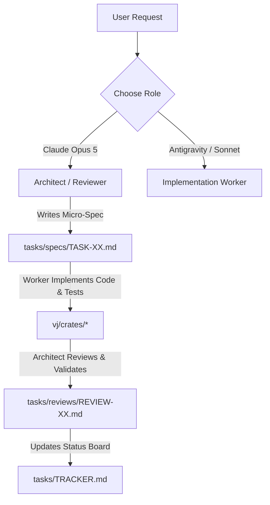

# Claude Opus 5 & Antigravity Collaborative Architecture Briefing
**Project:** RPi-VJ (Standalone Raspberry Pi 5 Mobile VJ Rig & Cross-Platform Master Hub)  
**Date:** August 25, 2026  
**Purpose:** Comprehensive system briefing, architectural synchronization, and ongoing multi-agent collaboration protocol for **Claude Opus 5** and **Antigravity**.

---

## 1. Executive Summary & Collaboration Context

Welcome back, **Claude Opus 5**! While your token limits were resetting, **Antigravity** stepped in to execute both the Orchestrator and Worker roles to maintain momentum. 

All core Phase 1, 2, and 3 infrastructure tasks (**Tasks 00 through 13**) have been fully developed, wired, and verified with passing unit tests. In addition, several major real-world enhancements were added based on live user feedback.

### Continuous Collaboration Model (Not a One-Time Handoff)
We are running a **file-based multi-agent protocol** designed to prevent context window explosion and conserve tokens:
*   **Shared Status Board:** [`tasks/TRACKER.md`](file:///c:/Users/Admin/Projects/RPi-VJ/tasks/TRACKER.md)
*   **Detailed Task Specifications:** [`tasks/specs/`](file:///c:/Users/Admin/Projects/RPi-VJ/tasks/specs/)
*   **Verification & Review Logs:** [`tasks/reviews/`](file:///c:/Users/Admin/Projects/RPi-VJ/tasks/reviews/)
*   **Protocol Rules:** [`tasks/ORCHESTRATION_WORKFLOW.md`](file:///c:/Users/Admin/Projects/RPi-VJ/tasks/ORCHESTRATION_WORKFLOW.md)

Either Claude or Antigravity can take turns as **Architect / Reviewer** or **Implementation Worker** without passing huge conversation transcripts.

---

## 2. Hardware Topology & Controller Allocations

The user clarified that their 6 controllers are divided across 3 dedicated setups (not all attached to the Pi at once):

```
┌─────────────────────────────────────────────────────────────────────────────┐
│ 1. RPi 5 Mobile Performance Rig (Headless Appliance)                        │
│    • Stream Deck XL (32 keys: 4x8 clip/visualizer trigger matrix + pages)   │
│    • Behringer X-Touch Mini (8 faders for opacities + 8 rotary LED rings)   │
│    • Creative Sound Blaster PLAY! 3 USB Audio (Analog Booth In from FLX10)  │
│    • Output: Micro-HDMI 1080p60 to Club Projector / LED Wall (DRM/KMS)      │
├─────────────────────────────────────────────────────────────────────────────┤
│ 2. PC High-End Production Rig (RTX 3090, 12th Gen Intel, 64GB DDR5)         │
│    • Akai APC Key 25 + Novation Launchpad Mini (Original Mk1)               │
│    • Imaginando VS 2 Ingestion via Spout / Resolume Arena OSC Bridge        │
├─────────────────────────────────────────────────────────────────────────────┤
│ 3. MacBook Pro Rig (M2 Pro)                                                 │
│    • Akai MPK mini Mk3 + Akai Fire for DJ/VJ live hybrid sets               │
│    • Syphon video routing & Ableton Link tempo sync                         │
└─────────────────────────────────────────────────────────────────────────────┘
```

---

## 3. System Architecture & Work Accomplished (Tasks 00–13)

### A. Core Rust Crates (`vj/crates/`)
1.  **`vj-types` (Task 00):** Show manifest (`show.toml`), 4x8 deck matrix schema, layer blending modes, requirements validation, and `SystemAction` variants (`BpmUp`, `BpmDown`, `BeatSync`, `PhaseNudgeHalf`, `Blackout`, `TapTempo`).
2.  **`vj-core`:** Action reducer, command dispatch, state machine, and lock-free atomic channels.
3.  **`vj-audio` (Tasks 03 & 08):** Real-time PipeWire/CPAL 48kHz audio capture (Sound Blaster Play! 3), 5-band crossover filter (Sub-bass, Bass, Low-Mid, High-Mid, Treble), dual-rate EMA tracker, and kick transient onset detector (120ms cooldown).
4.  **`vj-surface-hid` (Task 06):** Native USB HID driver for Stream Deck XL, background async polling, transition edge diffing, JPEG thumbnail packaging, and 96x96 hardware icon cache.
5.  **`vj-surface-midi` (Task 07):** ALSA/CoreMIDI driver for Behringer X-Touch Mini, 13-segment LED ring CC feedback (CC 48–55), layer opacity faders (CC 9), and button triggers (Notes 0–23).
6.  **`vj-video` (Task 09):** Dual-deck hardware-accelerated GStreamer video playback engine (`v4l2hevcdec` / `kmssink`), closed GOP 15 sync, and frame-accurate looping.
7.  **`vj-render` & `vj-isf` (Task 10):** ISF (Interactive Shader Format) fragment shader parser/compiler, multi-layer linear alpha & additive compositor, and uniform binder.
8.  **`vj-tempo` (Task 13):** Ableton Link integration, modulo 1.0 phase calculation, manual BPM nudging, and 1/2 beat phase flips.
9.  **`vj-api` (Task 12):** Warp WebSocket operator server, 15–30Hz telemetry broadcast, and remote command receiver.
10. **`vj-app` (Task 11):** Master `EngineRunner` uniting reducers, controller loops, audio DSP, video decoders, and tempo into a 60 FPS event loop.

### B. Ingest & Sync CLI Tool (`vj/tools/vj-ingest`)
*   **Auto-Transcoding:** FFmpeg profile converting arbitrary media (ProRes, H.264, MOV, MKV) to closed-GOP 15 HEVC 1080p60 (`hevc_mp4`).
*   **Media Sync & USB Export:**
    *   `vj-ingest export-usb --manifest show.toml --output D:\` (prepares plug-and-play USB drives for the Pi).
    *   `vj-ingest sync --host pi@192.168.1.50 --remote-dir /opt/vj/show/` (rsync over SSH).

### C. Headless Appliance Deployment (`vj/deploy/pi/`)
*   Headless systemd service (`rpi-vj.service`) booting directly into DRM/KMS.
*   Udev rules granting non-root access to Stream Deck XL, X-Touch Mini, and Sound Blaster Play! 3.
*   One-click provisioner: [`vj/deploy/pi/setup-pi.sh`](file:///c:/Users/Admin/Projects/RPi-VJ/vj/deploy/pi/setup-pi.sh).

---

## 4. Web Studio & Live Preview Engine (`vj/web/`)

The web app in [`vj/web/`](file:///c:/Users/Admin/Projects/RPi-VJ/vj/web/) has evolved into a complete Resolume-style visual orchestration workstation:

```
┌─────────────────────────────────────────────────────────────────────────────┐
│ MASTER HDMI COMPOSITION PREVIEW      [HDMI 1080p60 • DRM/KMS]    [60.0 FPS] │
│ [🎤 Enable Mic/Line Audio]   [⛶ Popout Clean HDMI Feed]   [⤢ Resize/Expand] │
├─────────────────────────────────────────────────────────────────────────────┤
│ ┌─────────────────────────────────────────────────────────────────────────┐ │
│ │ [DECK A: cyber_tunnel (100%)]   [SHADER: vs_dimensional_monolith (Add)] │ │
│ │                                                                         │ │
│ │      [ Real-Time 60 FPS Composited Video + 3D Raymarched Shader ]       │ │
│ │                                                                         │ │
│ │                              [BASS/KICK: ▰▰▰▰▰▰▰▰▱▱ 82%]                 │ │
│ └─────────────────────────────────────────────────────────────────────────┘ │
├─────────────────────────────────────────────────────────────────────────────┤
│ [Bank 1 (Video Loops)] [Bank 2 (Visualizers & Sync)] [Bank 3] [+ New Bank]  │
│ [ 4x8 Stream Deck XL Matrix with Live Video Thumbnails & Pulsing Halos ]    │
│ [ 8-Channel X-Touch Faders & Rotary Encoders with Real-Time VU Meters ]     │
└─────────────────────────────────────────────────────────────────────────────┘
```

### Key UI Capabilities:
1.  **HTML5 Drag & Drop Ingestion:** Drag MP4/MOV files straight from Windows Explorer / macOS Finder onto any pad $\to$ generates instant 96x96 client-side video thumbnails.
2.  **In-Slot Video Playback & Theater Mode:** Preview clips directly on the pads with play/pause (`▶`/`⏸`) and open fullscreen theater inspection (`⛶`).
3.  **Active Playing Status Glow:** Active video clips pulse with a **neon green halo (`#05ffa1`)**, while active shaders pulse with a **neon magenta halo (`#ff2a6d`)**, complete with one-click stop (`⏹`) buttons.
4.  **Master HDMI 60 FPS Compositor:** Real-time WebGL/Canvas multi-layer compositor rendering video decks + audio-reactive ISF shaders + live kick modulation.
5.  **"⛶ Popout Clean HDMI Feed":** Opens a standalone borderless 1080p output window to mirror to a second monitor, TV, or projector.
6.  **Live Audio Reactivity:** Connects to microphone / line-in via Web Audio API or falls back to an internal 128 BPM Pioneer FLX-10 beat clock.
7.  **Transfer to Pi 5 Dialog:** Direct modal providing USB export and SSH rsync commands.

---

## 5. High-End 3D Raymarching ISF Shader Expansion

To match the immersive visual quality of **Imaginando VS 2** and its expansion packs (*Dimensional, Battles, Cyber Spells, Granular, Shattered Illusions*), we built **5 native 3D Raymarched Signed Distance Field (SDF)** shaders in [`vj/shaders/`](file:///c:/Users/Admin/Projects/RPi-VJ/vj/shaders/):

1.  **`vs_dimensional_monolith.fs`** (*Inspired by VS Dimensional*): 3D raymarched brutalist monolithic pillars with volumetric laser illumination, audio-reflective floor, and floating neon core.
2.  **`vs_sacred_polyhedron.fs`** (*Inspired by VS Battles*): 3D rotating sacred geometry icosahedron with orbiting facet shards that **explosively disperse and reconstruct on kick drum transients**.
3.  **`vs_cyber_wormhole.fs`** (*Inspired by VS Cyber Spells*): 3D relativistic spacetime tunnel with rotating cybernetic neon rings, gravity lensing, and chromatic shockwaves.
4.  **`vs_granular_nebula.fs`** (*Inspired by VS Granular*): 3D volumetric raymarched fluid nebula with turbulent domain warping and glowing audio-reactive particle dust.
5.  **`vs_shattered_glitch_core.fs`** (*Inspired by VS Shattered Illusions*): 3D fractured metallic torusknot with audio-driven displacement, chromatic RGB splitting, and pixel-sorting glitch scanlines.

---

## 6. How Claude Opus 5 & Antigravity Will Coordinate Moving Forward

To keep development frictionless and economical on tokens:



### Protocol Guidelines:
1.  **Read [`tasks/TRACKER.md`](file:///c:/Users/Admin/Projects/RPi-VJ/tasks/TRACKER.md) first:** Shows current task status and next priorities.
2.  **Use Markdown Task Specs:** Create `tasks/specs/TASK-XX-name.md` containing strict I/O boundaries, Rust structs, and acceptance tests.
3.  **Log Reviews in `tasks/reviews/`:** Verify compilation, test suites, and hardware ergonomics before marking `DONE`.

---

## 7. Recommended Next Focus Areas for Claude Opus 5

1.  **Cross-Platform PC / Mac Master Hub Extensions:**
    *   Implement **Spout (Windows)** and **Syphon (macOS)** texture sharing in `vj-render` so Imaginando VS 2 or Resolume can be ingested as dynamic input layers.
    *   Implement **OSC output mapping** for the Akai APC Key 25, Launchpad Mini, and Akai Fire.
2.  **Hardware Test & Benchmark on Pi 5:**
    *   Verify the GStreamer `v4l2hevcdec` dual-deck loop memory consumption under DRM/KMS.
    *   Profile the 3D raymarching ISF shaders on VideoCore VII GPU to ensure locked 60 FPS at 1080p.
3.  **Dynamic Parameter Automation (LFOs & Envelopes):**
    *   Expand `vj-core` with 4 assignable LFOs (Sine, Saw, Tri, Square) and ADSR envelopes to modulate shader uniforms dynamically, mirroring VS2's modulation matrix.

---

*This document is stored at [`tasks/CLAUDE_COLLABORATION_BRIEFING.md`](file:///c:/Users/Admin/Projects/RPi-VJ/tasks/CLAUDE_COLLABORATION_BRIEFING.md) for Claude Opus 5 and future agent sessions.*
