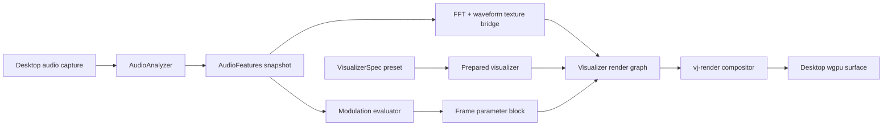

# Desktop Visualizer Master Development Plan

## Outcome

The desktop VJ application will render original, live audio-reactive Cartesian and radial visualizers, persistent spectrum history, bloom, and compositing at 1080p60 on the RTX 3090. Presets are typed show assets, prepared before activation, switched without compilation or allocation on the render thread, and driven by live FFT/waveform textures plus bounded scalar modulation.

This plan intentionally excludes Boris code/assets, Mocha tracking, AI masks, an editor UI, and the older Chromium renderer.

## Architecture



Thread rules:

- Capture callback only copies samples into a bounded ring.
- Analyzer owns FFT state and publishes a fixed-size snapshot.
- Control/reducer owns desired preset and base parameters.
- Index/preparation work validates presets and creates pipeline plans off the live trigger path.
- Render thread owns every GPU object and performs no steady-state heap allocation.

## Stable contracts

- `AudioFeatures`: 256 FFT bins, 256 waveform samples, volume/bands/onset/tempo.
- `VisualizerSpec`: serializable creative intent; contains no GPU objects.
- `PreparedVisualizer`: validated pipelines and a fixed resource plan.
- `VisualizerFrameParams`: fixed GPU-friendly values after base parameters and audio modulation are combined.
- Intermediate format: `wgpu::TextureFormat::Rgba16Float`.
- Allowed internal scales: 0.25, 0.5, 1.0.
- Workstation budget: 8 shader passes; preset validation rejects excess before activation.

## Delivery waves

### Wave A — contracts and real audio data

`VZ-01`, `VZ-02`, `VZ-03`, `VZ-04`

Produces typed preset/resource contracts, a real FFT, deterministic fixtures, and a reusable desktop surface host.

### Wave B — GPU inputs and primitive visualizer

`VZ-05`, `VZ-06`, `VZ-07`

Produces 256×1 GPU textures, frame uniforms, Cartesian/radial analytic primitives, and a visible live visualizer.

### Wave C — persistence and post-processing

`VZ-08`, `VZ-09`, `VZ-10`

Adds ring-buffer spectrum history, pooled render targets, bloom, and the bounded render graph.

### Wave D — state, presets, and application integration

`VZ-11`, `VZ-12`, `VZ-13`, `VZ-14`

Adds typed show presets, modulation, command/reducer lifecycle, and live desktop application wiring.

### Wave E — creative content and release gates

`VZ-15A`, `VZ-15B`, `VZ-15C`, `VZ-16`, `VZ-17`

Adds three original presets, metrics, visual QA, and the workstation soak test.

## Dependency graph

```text
VZ-01 ───────────────┬────────> VZ-11 ──> VZ-13 ──> VZ-14
                    └────────> VZ-12 ───────┘
VZ-02 ──> VZ-03 ──> VZ-05 ──> VZ-07 ──> VZ-10 ──> VZ-14
VZ-04 ─────────────> VZ-05 ──> VZ-06 ──┘
                                  VZ-08 ─┐
VZ-07 ───────────────────────────> VZ-08 ├─> VZ-10
VZ-06 ───────────────────────────> VZ-09 ┘
VZ-11 + VZ-12 + VZ-14 ──> VZ-15A/B/C ──> VZ-16 ──> VZ-17
```

`VZ-15A`, `VZ-15B`, and `VZ-15C` may run in parallel.

## Merge strategy

- One task per branch/commit when the orchestration environment supports it.
- Merge shared contracts first: VZ-01, VZ-02, VZ-04.
- Rebase dependent tasks after their prerequisites merge; do not resolve semantic conflicts by accepting both sides.
- `vj-render/src/lib.rs`, `vj-app/src/runner.rs`, and `vj-types/src/show.rs` are convergence points. Only the task explicitly owning one of these files may edit it during that wave.
- Run `cargo fmt --all` and `cargo test --workspace` from `vj/` after each merged wave.

## Quality gates

Functional:

- Synthetic 1 kHz input peaks in the expected perceptual FFT region.
- Silence stays visually inactive and finite.
- Cartesian and radial presets respond independently to bass, mids, and treble.
- Preset switches preserve the previous visual until the replacement is ready.
- Persistent buffers reset deterministically when requested.

Performance on the RTX 3090:

- Standard 1080p preset: p99 GPU frame time below 14 ms.
- No pipeline compilation or resource allocation during activation.
- No monotonic process or GPU-memory growth during preset cycling.
- Eight-hour mixed audio/preset/clip soak without device loss or uncaught error.

## Key trade-offs

- Fragment SDF primitives precede instanced geometry: less infrastructure and adequate for hundreds of bars/dots.
- CPU peak state precedes GPU peak state: deterministic, cheap, and testable.
- Half-resolution separable bloom precedes full-resolution or multi-sample blur.
- Particle fields are deferred until the core graph passes its soak gate.
- The desktop implementation uses shared tier contracts so the Pi can degrade later, but Pi parity is not an acceptance criterion here.

## Revisit after MVP

- Compute/instanced particle subsystem.
- GPU-generated spectrum mesh if it outperforms the history-height-field shader.
- Desktop authoring UI.
- 4K60 quality tiers.
- Pi substitutes and M2 Pro validation.

